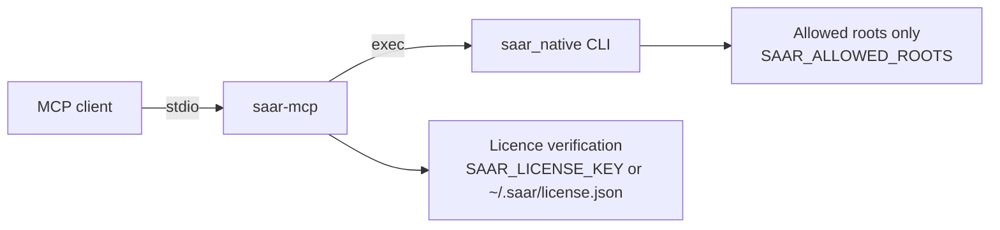

# Saar MCP server

`@heossihq/saar-mcp` exposes Saar's lossless compression through MCP. The server
is a thin driver: it does not contain the compressor, and it calls the installed
`saar_native` executable.

## Requirements

- Node.js 20+
- Saar `saar_native` 1.0.0 or later, path supplied via `SAAR_NATIVE_BINARY`

## Tools

| Tool | Purpose |
| --- | --- |
| `saar_compress_file` | Compress a file |
| `saar_decompress_file` | Restore a compressed file |
| `saar_version` | Report engine and CLI versions |
| `saar_license_status` | Report licence state |

## Configuration

| Variable | Meaning |
| --- | --- |
| `SAAR_NATIVE_BINARY` | Path to the native executable (required) |
| `SAAR_ALLOWED_ROOTS` | Delimited list of permitted directories; defaults to the current directory |
| `SAAR_LICENSE_KEY` | Signed licence token (or `~/.saar/license.json`) |
| `SAAR_REQUIRE_LICENSE` | `1` requires a valid licence with the `mcp` feature |

Evaluation mode is reported honestly by `saar_license_status`; it is never
presented as a licensed state.

## Client configuration

Templates for Claude Desktop, Cursor, VS Code and OpenCode are in [`configs`](./configs).
